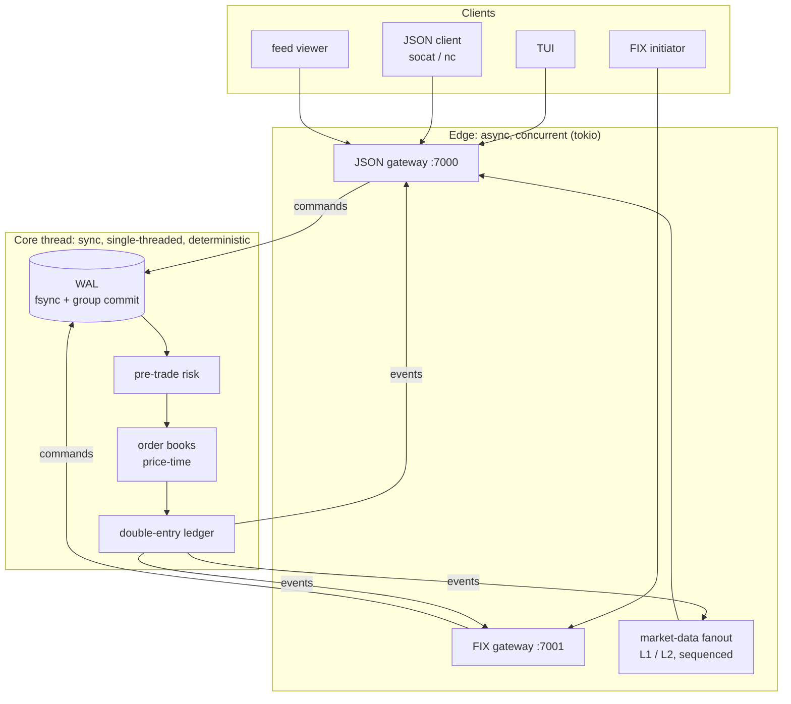

# Exchange — a deterministic matching engine in Rust

[](https://github.com/gengibrepower/exchange/actions/workflows/ci.yml)


[](LICENSE)

🇧🇷 [Leia em português](README.pt-BR.md)

A trading-engine simulator built from scratch: price-time matching, double-entry settlement, a write-ahead log with crash recovery, a market-data feed, a hand-written **FIX 4.4** session layer, and a terminal client. It runs in the terminal, and every behavior is backed by property-based tests.

> **This is a personal learning project, not a real exchange.** No real money, no customers, not in production. It exists to practice the engineering of high-correctness systems.

<!-- TUI screenshot: docs/img/tui.png -->

## Highlights

| | |
|---|---|
| **2.9 M orders/s** on one thread | full `Engine::apply` (risk → reserve → match → settle), p50 ≈ 300 ns, p99 ≤ 2.6 µs |
| **609 tests**, property-based where it matters | thousands of random order flows checked against reference models and invariants |
| **Crash-tested WAL** | crash injected at *every byte* of the log, a bit flipped in every byte, a tail of zeros: boot always rebuilds the exact state |
| **FIX 4.4 written by hand** | codec + session (logon, heartbeat, resend, gap fill); dropped connections recover without losing or duplicating an order |
| **Zero `unsafe`, zero floats for money** | `#![forbid(unsafe_code)]` in every crate; prices and quantities are integer newtypes |
| **Lean dependencies** | the core depends only on `serde` + `postcard`; the FIX crate has no dependencies at all |

## Why this is hard

Toy matching engines are easy. This project goes after the four properties that make a real one hard ([scope](docs/escopo.md), section 1):

1. **Determinism as a design discipline.** The same input sequence always produces exactly the same state and the same trades. The core never reads a clock, never spawns a thread, never touches a float; time enters as data inside the command.
2. **An atomic reserve → match → settle chain that never unbalances money.** Under partial fills, cancels and crashes, the sum of every balance of every asset (including the fee account) stays constant.
3. **Recovery by event sourcing.** The log is the source of truth. State is rebuilt by replaying it, and snapshots are only a shortcut.
4. **Protocol session correctness.** FIX sequence numbers, resend requests and gap fills, so a client that loses its connection mid-order neither loses nor duplicates it.

## Architecture

The system has two halves with opposite natures, and they talk **only through channels** (single-writer pattern, as in the LMAX Disruptor):



If the core became `async` with locks, determinism, replay and recovery would all go with it. That separation is the backbone of the project.

| Crate | Role |
|---|---|
| [`core`](crates/core) | Order books, matching, ledger, engine. Pure and synchronous: commands in, events out |
| [`wal`](crates/wal) | Append-only log `[len][crc32][postcard]`, batched `fsync`, atomic snapshots |
| [`fix`](crates/fix) | FIX 4.4 codec and session state machine. Pure: no clock, no network, no dependencies |
| [`protocol`](crates/protocol) | JSON wire types shared by the server and its clients |
| [`edge`](crates/edge) | `tokio` TCP server (JSON + FIX), core thread, sequencer, market-data feed, CLI |
| [`tui`](crates/tui) | Terminal client (`ratatui`). Speaks only the wire protocol and never links the core |

## Quick start

Requires Rust (the toolchain is pinned in `rust-toolchain.toml`) and, for the third terminal, `socat`.

```sh
# terminal 1: the server (JSON on :7000, FIX on :7001)
cargo run -p edge --bin server

# terminal 2: the terminal client, as account 1
cargo run -p tui -- --account 1

# terminal 3: another account places a sell order
socat - TCP:127.0.0.1:7000
{"type":"login","account":2}
{"type":"deposit","asset":"TESTE","amount":100000}
{"type":"limit","instrument":"TESTE/BRL","side":"sell","price":10050,"lots":7}
```

In the TUI, `]` opens the `TESTE/BRL` tab, and the order shows up in the live book. `?` lists the keys. For an in-process REPL with no network, run `cargo run -p edge` instead. Add `--wal exchange.wal` to either one to persist state, then restart it and watch the log replay.

## How correctness is tested

The invariants in section 3.5 of the scope are the definition of correct. Each one is checked by `proptest` over thousands of random command streams:

- **Book never crossed**, and **price-time priority**: matching is compared against a naive reference model.
- **Conservation of value**: per asset, `available + reserved` summed over all accounts, house account included, never changes.
- **Consistent reservation**: every resting order has its funds locked, and a cancel releases exactly what was locked.
- **Balances against an independent oracle** that recomputes them from scratch.

The persistence layer is tested just as hard:

- **Replay determinism:** restarting from the log, with or without a snapshot, rebuilds the same state as a session that never stopped, and the same state always serializes to the same bytes.
- **WAL:** crash at every byte offset, bit flips at every byte, and zeroed tails. Boot must recover exactly the commands that fully reached the disk, and must refuse to start on a valid but inconsistent record.
- **Snapshot:** a crash at any point of the write leaves either the old snapshot or the new one, never a mix.
- **FIX:** a property test runs two sessions over a simulated TCP that drops at random points, loses in-flight data and delivers extra resends. Each side must receive exactly what the other sent, once and in order. An integration test then kills the connection after the order reached the core but before the ack was read.

CI runs `cargo fmt --check`, `cargo clippy -D warnings` (pedantic) and `cargo test --workspace` on every PR, and master only accepts merges that pass.

## Performance

AMD Ryzen 5 PRO 5650U (laptop), `bench` profile. Full numbers and methodology are in [docs/benchmarks.md](docs/benchmarks.md).

| Core scenario | Throughput | p50 | p99 | p99.9 |
|---|---|---|---|---|
| `resting` (nothing crosses) | 2.87 M cmd/s | 321 ns | 742 ns | 5.24 µs |
| `crossing` (half crosses) | 1.89 M cmd/s | 311 ns | 2.62 µs | 3.87 µs |
| `with_cancels` | 2.14 M cmd/s | 251 ns | 2.26 µs | 3.67 µs |

Durability costs almost everything: one `fsync` per command caps the server at a few hundred commands/s. **Group commit** lets commands that arrive during an `fsync` share the next one, so 64 concurrent sessions reach 7–21 k durable cmd/s, 10–30× more, with no artificial batching delay. **Snapshots** cut the boot of a 1 M-command log from 1.33 s to 0.37 s.

## Engineering decisions

The full list, with the reasoning behind each choice, is in section 11 of the [scope](docs/escopo.md). These are the ones with the most interesting trade-offs:

- **Integer money, no division.** Quantity is in lots and price is in minimum quote units per lot, so a trade's value is `price × lots`, exact and deterministic. Floats would make replay non-reproducible.
- **Single-threaded core.** One thread, N books, one global ledger. Matching and ledger talk by message, never by shared state, so a thread per instrument later means swapping a call for a channel send. The ledger stays the serialization point anyway: every trade touches two accounts and the house.
- **`fsync` per record first, group commit when the benchmark asked for it.** The WAL benchmark showed `fsync` was ~99% of the cost before any batching was added.
- **The log stays whole.** Snapshots skip replay but don't truncate the log. A snapshot that claims more commands than the log holds stops the boot, because there is no way to tell which of the two is right.
- **Slow consumers never block the core.** Feed subscribers that fall behind see a sequence gap and resubscribe for a fresh snapshot. A private-report session that stops reading gets disconnected, because silently dropping a fill would be worse.
- **The TUI never touches the core.** It is a separate crate that speaks the public protocol, which also keeps the protocol honest.

## Status

All planned phases are done (scope, section 12):

| Phase | Delivered |
|---|---|
| F0–F1 | Domain model, price-time matching, market orders, partial fills, GTC / IOC / FOK, cancel |
| F2 | Accounts, reservations, double-entry ledger with taker fee, pre-trade risk (max size, price collar) |
| F3 | WAL with per-record `fsync`, boot-time recovery, deterministic replay |
| F4 | `tokio` TCP server with a line-delimited JSON protocol; the core runs on its own thread behind channels |
| F5 | L1 / L2 market-data feed: snapshot + sequenced increments, gap detection and recovery |
| F6 | FIX 4.4: codec, session, `NewOrderSingle` / `OrderCancelRequest` / `ExecutionReport` |
| F7 | Benchmarks, group commit, a second instrument, stop orders, private reports, snapshots |
| F8 | Terminal client: live book, trades, orders, balances, order ticket, cancel, auto-reconnect |

## Reference documentation (Portuguese)

- [docs/escopo.md](docs/escopo.md): scope, architecture, domain rules and closed decisions
- [docs/cli.md](docs/cli.md): CLI commands, instruments, WAL and snapshots
- [docs/protocolo.md](docs/protocolo.md): JSON protocol and market-data feed
- [docs/fix.md](docs/fix.md): FIX session and application messages
- [docs/tui.md](docs/tui.md): terminal client and key bindings
- [docs/benchmarks.md](docs/benchmarks.md): methodology and full results

## License

MIT. See [LICENSE](LICENSE).
