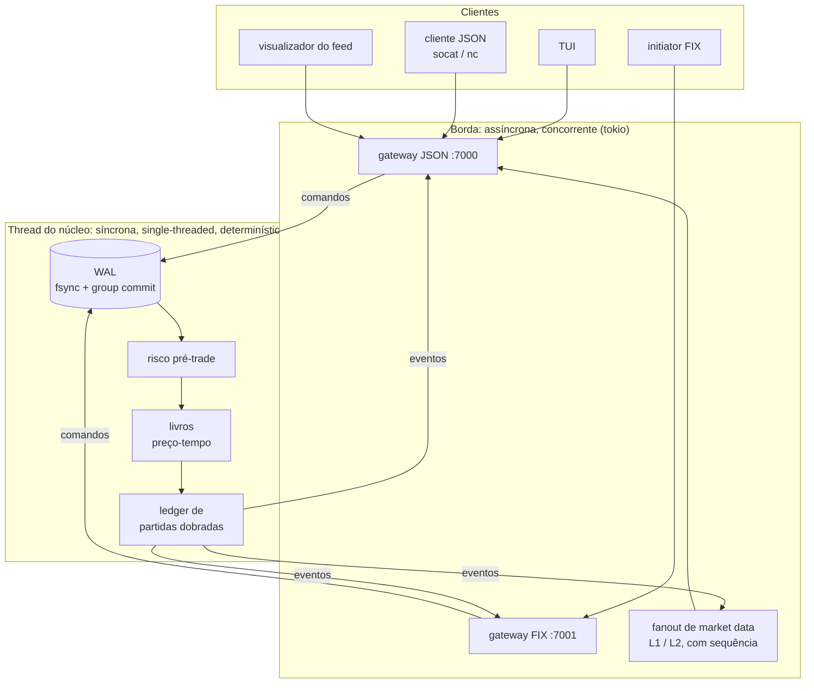

# Exchange — motor de negociação determinístico em Rust

[](https://github.com/gengibrepower/exchange/actions/workflows/ci.yml)


[](LICENSE)

🇺🇸 [Read in English](README.md)

Simulador de motor de negociação construído do zero: matching por prioridade preço-tempo, liquidação por partidas dobradas, WAL com recuperação de crash, feed de market data, sessão **FIX 4.4** escrita à mão e um cliente de terminal. Tudo roda no terminal, e todo comportamento é sustentado por testes de propriedade.

> **Projeto pessoal de aprendizado, não uma exchange real.** Sem dinheiro real, sem clientes, fora de produção. Existe para praticar a engenharia de sistemas de alta corretude.

<!-- screenshot da TUI: docs/img/tui.png -->

## Destaques

| | |
|---|---|
| **2,9 M ordens/s** numa thread | `Engine::apply` inteiro (risco → reserva → matching → liquidação), p50 ≈ 300 ns, p99 ≤ 2,6 µs |
| **609 testes**, de propriedade onde importa | milhares de fluxos aleatórios conferidos contra modelos de referência e invariantes |
| **WAL testado contra crash** | crash injetado em *cada byte* do log, um bit trocado em cada byte, rabo de zeros: o boot sempre reconstrói o estado exato |
| **FIX 4.4 escrito à mão** | codec e sessão (logon, heartbeat, resend, gap fill); queda de conexão é recuperada sem perder nem duplicar ordem |
| **Zero `unsafe`, zero float para dinheiro** | `#![forbid(unsafe_code)]` em toda crate; preço e quantidade são newtypes inteiros |
| **Dependências enxutas** | o núcleo depende só de `serde` e `postcard`; a crate FIX não tem dependência nenhuma |

## Por que é difícil

Um motor de matching de brinquedo é fácil. Este projeto mira as quatro propriedades que tornam um motor real difícil ([escopo](docs/escopo.md), seção 1):

1. **Determinismo como disciplina de projeto.** A mesma sequência de entrada produz sempre exatamente o mesmo estado e os mesmos negócios. O núcleo nunca lê relógio, nunca cria thread e nunca usa float; o tempo entra como dado dentro do comando.
2. **A cadeia atômica reservar → casar → liquidar, que nunca desbalanceia o dinheiro.** Sob execução parcial, cancelamento e crash, a soma dos saldos de cada ativo (conta da casa incluída) fica constante.
3. **Recuperação por event sourcing.** O log é a verdade. O estado é reconstruído relendo o log, e o snapshot é só um atalho.
4. **Corretude de sessão de protocolo.** Números de sequência FIX, resend request e gap fill fazem com que o cliente que perde a conexão no meio de uma ordem não a perca nem a duplique.

## Arquitetura

O sistema tem duas metades de naturezas opostas, que conversam **só por canais** (padrão single-writer, como o LMAX Disruptor):



Se o núcleo virasse `async` com locks, o determinismo, o replay e a recuperação morreriam juntos. Essa separação é a espinha dorsal do projeto.

| Crate | Papel |
|---|---|
| [`core`](crates/core) | Livros de ofertas, matching, ledger e engine. Puro e síncrono: entra comando, sai evento |
| [`wal`](crates/wal) | Log append-only `[tamanho][crc32][postcard]`, `fsync` em lote e snapshots atômicos |
| [`fix`](crates/fix) | Codec e máquina de estados da sessão FIX 4.4. Pura: sem relógio, sem rede, sem dependências |
| [`protocol`](crates/protocol) | Tipos do protocolo JSON, compartilhados pelo servidor e pelos clientes |
| [`edge`](crates/edge) | Servidor TCP `tokio` (JSON e FIX), thread do núcleo, sequenciador, feed e CLI |
| [`tui`](crates/tui) | Cliente de terminal (`ratatui`). Fala só o protocolo e nem tem o núcleo no grafo de dependências |

## Rodando em um minuto

Precisa de Rust (a toolchain está fixada em `rust-toolchain.toml`) e, no terceiro terminal, do `socat`.

```sh
# terminal 1: o servidor (JSON na :7000, FIX na :7001)
cargo run -p edge --bin server

# terminal 2: o cliente de terminal, como conta 1
cargo run -p tui -- --account 1

# terminal 3: outra conta põe uma oferta de venda
socat - TCP:127.0.0.1:7000
{"type":"login","account":2}
{"type":"deposit","asset":"TESTE","amount":100000}
{"type":"limit","instrument":"TESTE/BRL","side":"sell","price":10050,"lots":7}
```

Na TUI, `]` abre a aba `TESTE/BRL` e a oferta aparece no livro ao vivo. `?` mostra as teclas. Para um REPL local, sem rede, rode `cargo run -p edge`. Com `--wal exchange.wal` em qualquer um dos dois, o estado é persistido: ao reiniciar, o log é reaplicado.

## Como a corretude é testada

As invariantes da seção 3.5 do escopo são a definição de correto. Cada uma é verificada por `proptest` sobre milhares de fluxos aleatórios de comandos:

- **Livro nunca cruzado** e **prioridade preço-tempo**: o matching é comparado com um modelo de referência ingênuo.
- **Conservação de valor**: por ativo, a soma de `disponível + reservado` de todas as contas, conta da casa incluída, não muda.
- **Reserva consistente**: toda ordem descansando tem o valor travado, e o cancelamento libera exatamente o que travou.
- **Saldos contra um oráculo independente**, que os recalcula do zero.

A persistência é testada com o mesmo rigor:

- **Determinismo de replay:** reiniciar a partir do log, com ou sem snapshot, reconstrói o mesmo estado de uma sessão que nunca parou, e o mesmo estado sempre vira os mesmos bytes.
- **WAL:** crash em cada byte, um bit trocado em cada byte e rabo de zeros. O boot precisa recuperar exatamente os comandos que chegaram inteiros ao disco, e precisa se recusar a subir diante de um registro íntegro mas inconsistente.
- **Snapshot:** um crash em qualquer ponto da gravação deixa o snapshot antigo ou o novo, nunca uma mistura.
- **FIX:** um teste de propriedade roda duas sessões num TCP simulado que cai em pontos aleatórios, perde o que estava em trânsito e entrega reenvios a mais. Cada lado precisa receber exatamente o que o outro enviou, uma vez e em ordem. Um teste de integração derruba a conexão depois de a ordem chegar ao núcleo e antes de a confirmação ser lida.

A CI roda `cargo fmt --check`, `cargo clippy -D warnings` (pedantic) e `cargo test --workspace` em toda PR, e a master só aceita merge que passe.

## Desempenho

AMD Ryzen 5 PRO 5650U (notebook), perfil `bench`. Os números completos e a metodologia estão em [docs/benchmarks.md](docs/benchmarks.md).

| Cenário do núcleo | Throughput | p50 | p99 | p99.9 |
|---|---|---|---|---|
| `resting` (nada cruza) | 2,87 M cmd/s | 321 ns | 742 ns | 5,24 µs |
| `crossing` (metade cruza) | 1,89 M cmd/s | 311 ns | 2,62 µs | 3,87 µs |
| `with_cancels` | 2,14 M cmd/s | 251 ns | 2,26 µs | 3,67 µs |

A durabilidade custa quase tudo: um `fsync` por comando limita o servidor a algumas centenas de comandos/s. Com **group commit**, os comandos que chegam durante um `fsync` dividem o próximo; com 64 sessões concorrentes, isso dá 7 a 21 mil comandos duráveis/s, de 10 a 30 vezes mais, sem espera artificial por lote. Os **snapshots** levam o boot de um log de 1 milhão de comandos de 1,33 s para 0,37 s.

## Decisões de engenharia

A lista completa, com o porquê de cada escolha, está na seção 11 do [escopo](docs/escopo.md). Estas são as de trade-off mais interessante:

- **Dinheiro inteiro, sem divisão.** Quantidade em lots e preço em unidades mínimas da quote por lot, então o valor do negócio é `preço × lots`, exato e determinístico. Com float, o replay deixaria de ser reproduzível.
- **Núcleo em uma thread.** Uma thread, N livros e um ledger global. Matching e ledger conversam por mensagem, nunca por estado compartilhado, então uma thread por instrumento no futuro é trocar uma chamada por um `send` em canal. O ledger continua sendo o ponto de serialização: todo negócio toca duas contas e a casa.
- **`fsync` por registro primeiro, group commit quando o benchmark pediu.** O benchmark do WAL mostrou que o `fsync` era ~99% do custo antes de existir qualquer lote.
- **O log fica inteiro.** O snapshot pula o replay, mas não corta o log. Um snapshot que diz cobrir mais comandos do que o log tem interrompe o boot, porque não há como saber qual dos dois está certo.
- **Consumidor lento nunca segura o núcleo.** Quem assina o feed e fica para trás vê o buraco na sequência e pede um snapshot novo. A sessão de relatórios privados que para de ler é desconectada, porque descartar um fill em silêncio seria pior.
- **A TUI nunca toca o núcleo.** É uma crate separada que fala o protocolo público, o que também mantém o protocolo honesto.

## Status

Todas as fases planejadas estão concluídas (escopo, seção 12):

| Fase | Entregue |
|---|---|
| F0–F1 | Modelo de domínio, matching preço-tempo, ordens a mercado, execução parcial, GTC / IOC / FOK, cancelamento |
| F2 | Contas, reservas, ledger de partidas dobradas com taxa de taker, risco pré-trade (tamanho máximo, colar de preço) |
| F3 | WAL com `fsync` por registro, recuperação no boot, replay determinístico |
| F4 | Servidor TCP `tokio` com protocolo JSON por linha; o núcleo roda numa thread própria, atrás de canais |
| F5 | Feed L1 / L2: snapshot e incrementos numerados, detecção de buraco e recuperação |
| F6 | FIX 4.4: codec, sessão, `NewOrderSingle` / `OrderCancelRequest` / `ExecutionReport` |
| F7 | Benchmarks, group commit, segundo instrumento, stop orders, relatórios privados, snapshots |
| F8 | Cliente de terminal: livro ao vivo, negócios, ordens, saldos, boleta, cancelamento, reconexão automática |

## Documentação de referência

- [docs/escopo.md](docs/escopo.md): escopo, arquitetura, regras de domínio e decisões fechadas
- [docs/cli.md](docs/cli.md): comandos do CLI, instrumentos, WAL e snapshots
- [docs/protocolo.md](docs/protocolo.md): protocolo JSON e feed de market data
- [docs/fix.md](docs/fix.md): sessão FIX e mensagens de aplicação
- [docs/tui.md](docs/tui.md): cliente de terminal e teclas
- [docs/benchmarks.md](docs/benchmarks.md): metodologia e resultados completos

## Licença

MIT. Ver [LICENSE](LICENSE).
